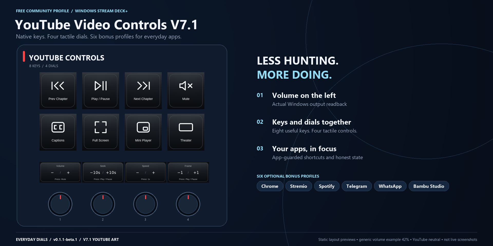
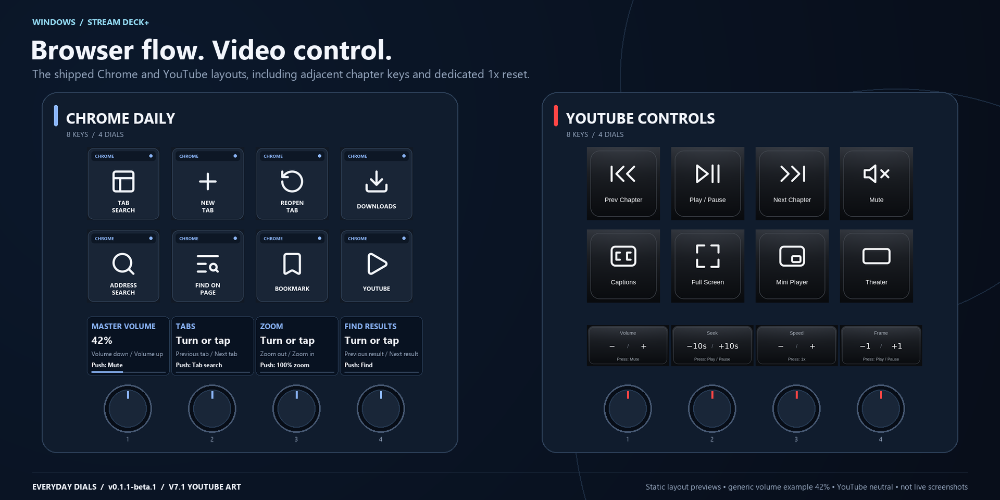
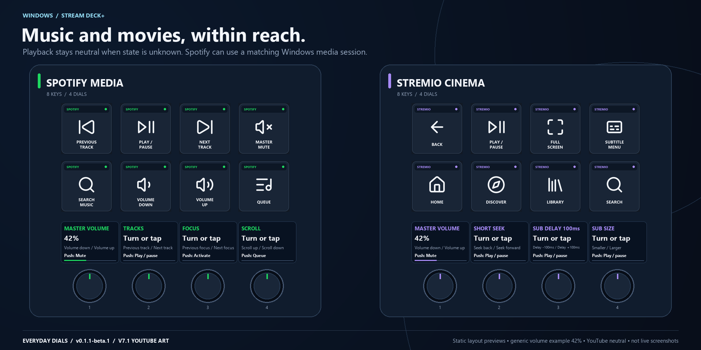
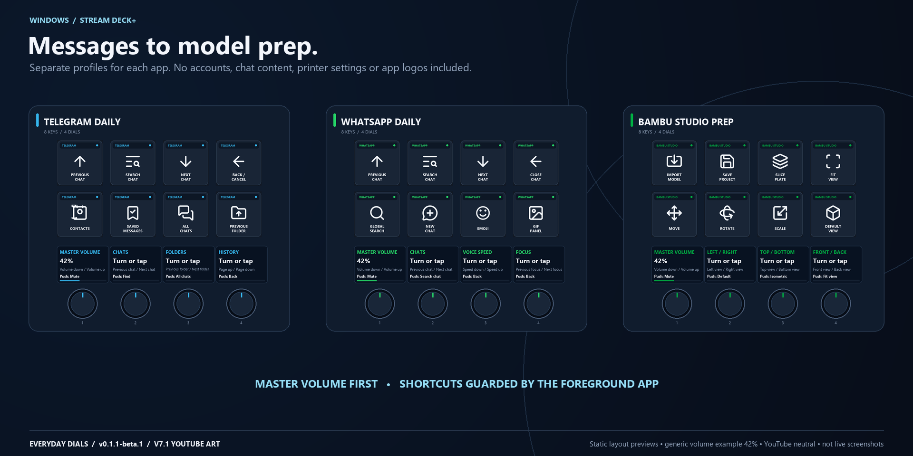
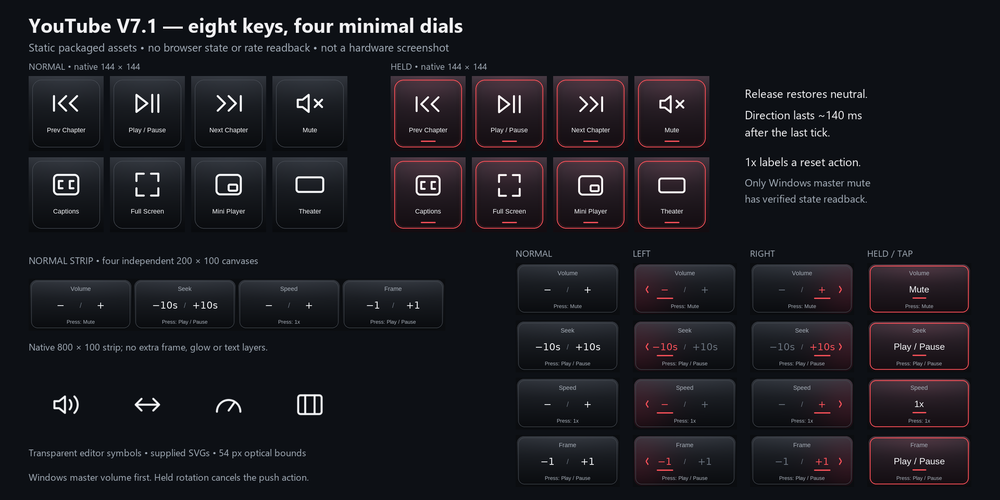
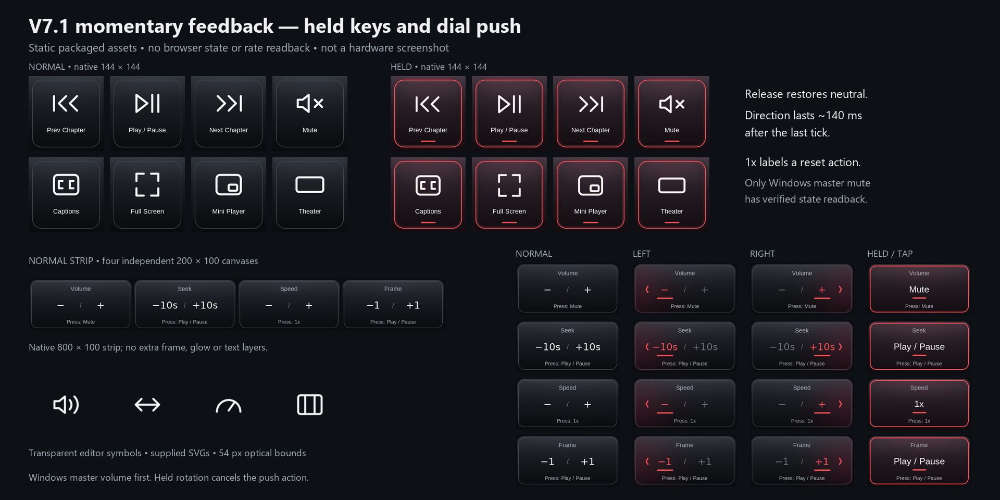

# YouTube Video Controls V7.1 for Stream Deck+

A free YouTube control profile for Windows Stream Deck+, with eight keys, four dials, readable V7.1 feedback and Windows master volume on the left. Six optional bonus profiles cover Chrome, Stremio, Spotify, Telegram, WhatsApp and Bambu Studio. The included plugin and download files use the technical package name **Everyday Dials**.

**v0.1.1-beta.1 — free public beta with V7.1 YouTube artwork.** This is an unsigned community plugin, independently distributed through [GitHub Releases](https://github.com/EzerchE/everyday-dials/releases), with no Elgato Marketplace approval. The V7.1 artwork removes the thin upper highlight and adds the supplied Press: 1x reset-action hint. Earlier controls received private UI review; this artwork update has no new hardware-test claim. YouTube speed decrease, increase and reset have received limited physical checks. All seven profiles and every shortcut have not completed hardware QA. AI assisted implementation, documentation and artwork composition.

## Install

1. Use a **Stream Deck+**, Windows 11 x64 (tested), and Stream Deck software **7.1.0 or newer for profile import**. The plugin itself has a 6.5 minimum and targets Windows 10 build 19041 or newer; Windows 10 was not separately hardware tested. The named desktop apps must be installed separately.
2. Install the [Microsoft .NET 8 x64 Runtime](https://dotnet.microsoft.com/en-us/download/dotnet/8.0) for Windows if it is missing. The plugin is framework dependent and requires `Microsoft.NETCore.App` 8.x; it does not bundle the .NET runtime. `dotnet --list-runtimes` can check this.
3. Download `Everyday-Dials-0.1.1-beta.1.zip` from [the release page](https://github.com/EzerchE/everyday-dials/releases/tag/v0.1.1-beta.1), extract it, and compare `SHA256SUMS.txt` if desired. Open `com.ezerche.everydaydials.streamDeckPlugin` to install the unsigned community plugin through Stream Deck. Review any operating system or Stream Deck prompt.
4. Open the `.streamDeckProfile` files you want and choose your Stream Deck+ as the target when prompted. They use new profile IDs and only the `com.ezerche.everydaydials` plugin. No third-party plugin is included.
5. Select a profile in Stream Deck and bring the corresponding app to the foreground. In YouTube, click the video/player, leave text fields, and then use its controls. Chapter buttons require chapters in that video. Start with quiet volume and a noncritical app view.

No account, payment, unlock or donation is required to use these files. If you want to support development, [buy me a coffee](https://buymeacoffee.com/ezerche) is entirely optional.

## What the controls do

See the complete [key and dial guide](KEY-DIAL-GUIDE.md). Each gallery is a static rendering of shipped assets. YouTube uses neutral browser state; generic app examples show illustrative Windows volume.

The YouTube profile uses creator-supplied **V7.1** normal/pressed keys and one native 200 × 100 PNG per dial canvas. Its minimal strip has no layered titles, tiny status prose, bars or percentage. Direction feedback lasts about 140 ms after the last turn. Keys return to neutral immediately on release, and dial press feedback stays visible while held. Speed push/tap retains the creator-confirmed 1× reset; “Press: 1x” labels the reset action, never a measured rate. See the [YouTube artwork guide](YOUTUBE-ARTWORK.md).

### Optional YouTube icon library

The bundle includes `Everyday-Dials-YouTube-Icon-Library-0.1.1-beta.1.zip`: the V7.1 library's 28 labeled normal/pressed key pairs, 16 native dial PNGs and clean SVG symbols. The profile assigns eight keys and four dials; the remaining icons are customization assets. Current previews below use the actual V7.1 packaged layout and disclose their static examples. V4 source assets/marketing remain archival and are not current setup instructions.

The leftmost dial changes actual **Windows master output** volume by 2 percentage points per detent; push or tap toggles mute. Only verified Windows master mute selects a muted canvas. The YouTube M key remains neutral because browser mute is unknown. Captions and player modes also remain neutral; no browser integration, connection or permission has been added. Other app volume dials retain their existing percentage/mute readback. Turning a dial while held cancels its release action.

The Chrome YouTube key opens the fixed `https://www.youtube.com/` address in Chrome at the standard Program Files installation location. This can open Chrome even if another app is foreground. Select the YouTube profile yourself afterward. Chrome installed elsewhere is not supported by that launcher.

## Known limits

- There is **no website detection or automatic URL-based profile switching**. Stream Deck's own app association cannot distinguish Chrome tabs. An optional third-party tool such as Easy Link must be installed and configured separately if you want URL switching; no mapping or plugin for it is shipped.
- YouTube and Stremio playback icons generally remain neutral when reliable state is unavailable. The plugin does not infer state from button presses. Spotify can display the next Play/Pause operation only when Windows exposes one unambiguous matching session; otherwise it also remains neutral. No media titles, URLs or chat content are read for this feedback.
- Speed reset sends 32 slower shortcuts and then three faster shortcuts to reach YouTube's normal 1x preset, assuming its standard 0.25x steps and lower bound. It is a bounded shortcut sequence, not playback-rate readback. Focus, YouTube changes or dropped input can affect it. Speed rotation uses explicit Shift+OEM comma/period packets to avoid AltGr punctuation problems.
- Application versions, focused panes, active text fields and keyboard layouts affect shortcuts. The app guard checks the foreground executable, not the current page or UI mode. App keys can act in an unintended text field inside the correct app. Windows may block input into an elevated app.
- Spotify scrolling requires the mouse pointer over the intended Spotify pane and no held modifier keys. The focus dial activates the focused control with Enter. Queue is a shortcut, not a queue-state indicator.
- Stremio controls target `stremio-shell-ng.exe`; WhatsApp targets `WhatsApp.Root.exe`. Other distributions or executable names may not match. WhatsApp voice-speed shortcuts depend on a selected voice message and app support. Bambu Studio controls are for view/preparation shortcuts; no printer account or printer settings are included.
- All 56 profile keys allow the plugin to manage their normal, pressed and available playback/mute images. Reliable state still depends on the matching Windows provider; full seven-profile hardware feedback QA remains incomplete.
- These profiles have no property inspector. Action settings are predefined in the profile source. A blank manually dragged action does not choose an app automatically. Export a backup through Stream Deck before changing your own setup.

## Build from source

Source targets .NET SDK 8.0.428 (latest installed patch allowed by `global.json`) and Windows SDK projection package 10.0.19041.57. On Windows x64, run `dotnet restore src/EverydayDials.csproj`, install the pinned local CLI with `npm.cmd ci --prefix tools`, then run `pwsh -File scripts/build.ps1`. The script builds, runs isolated fake-desktop self-tests, validates and packs with official Elgato CLI 1.10.5. It never links, installs or restarts a live plugin. Initial restore/npm install require internet access. The normal build uses the checked-in neutral artwork and sanitized profile source.

To regenerate images and profile containers, install Python 3 with Pillow and ImageMagick 7, then run `python scripts/build_assets.py` before building. `python scripts/make_media.py` creates the exact-layout galleries; `python scripts/prepare_youtube_library.py` renders current V7.1 galleries while retaining all originals. `python scripts/render_youtube.py` renders the actual single-pixmap SDK canvas as static examples. `python scripts/verify_release.py` checks profile structure, references, dependency hashes and privacy before generating distribution ZIPs. Build artifacts are under `artifacts/`; private caches, intermediate output and debug symbols are excluded from distribution.

## Privacy, rights and feedback

Read [PRIVACY.md](PRIVACY.md), [THIRD-PARTY-NOTICES.md](THIRD-PARTY-NOTICES.md) and [LICENSE](LICENSE). Original code/profile configuration/composition is MIT licensed. Lucide/Feather artwork and Microsoft binaries retain their respective terms. App names are descriptive trademarks of their owners; no affiliation or endorsement is implied. No proprietary app badges or logos are shipped.

Please [report an issue](https://github.com/EzerchE/everyday-dials/issues) with the profile name, app version, keyboard layout and focused UI area. Remove usernames, paths, chat content, URLs and device identifiers before sharing diagnostics. Do not upload your entire Stream Deck configuration.
