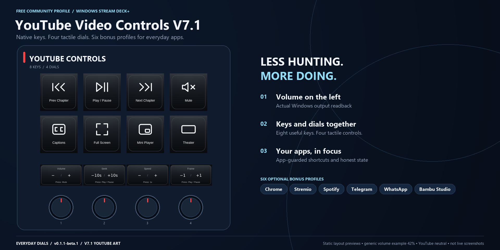
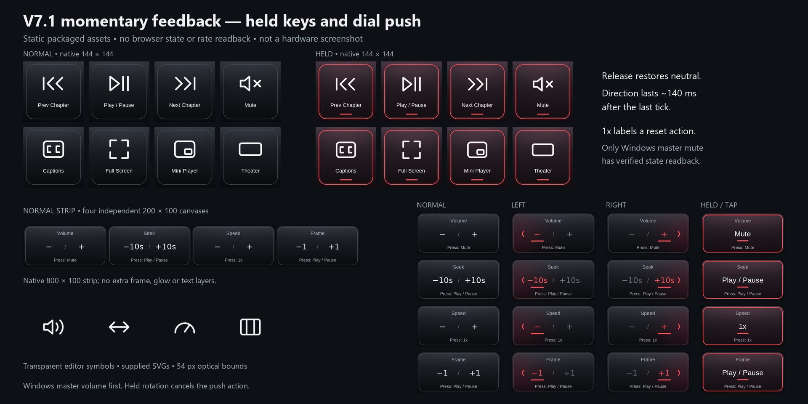

# YouTube Video Controls V7.1 for Stream Deck+

**v0.1.1-beta.1 — free public beta.** A dedicated YouTube profile with eight keys, four dials, native V7.1 artwork and Windows master volume on the left. Includes six optional bonus profiles for Chrome, Stremio, Spotify, Telegram, WhatsApp and Bambu Studio. No account, payment or donation is required. The included plugin and download files use the technical package name Everyday Dials.

## Included

- Seven independently importable profiles and the unsigned `com.ezerche.everydaydials` plugin.
- V7.1 YouTube artwork: native 144px keys, separate 200×100 dial canvases, consistent red held-press feedback and direction feedback that clears about 140ms after the last turn.
- All 56 keys allow SDK-managed normal, pressed and available media/mute artwork. Unknown player state stays neutral.
- YouTube chapter controls, J/L seek, frame stepping and explicit shifted OEM speed shortcuts. Speed push/tap retains the bounded 1× reset sequence; The supplied 1x label describes the reset action, not a measured rate.
- Source, checksums, English control guides, static layout galleries and an optional YouTube icon library.

V7.1 names the artwork design. The plugin manifest version is `0.1.1.0` and this GitHub prerelease is `v0.1.1-beta.1`.

## Install

1. Use Windows 11 x64 (tested), Stream Deck+ and Stream Deck software **7.1.0 or newer for profile import**. The plugin itself has a 6.5 minimum; its Windows 10 build 19041 target was not separately hardware tested.
2. Install the [Microsoft .NET 8 x64 Runtime](https://dotnet.microsoft.com/en-us/download/dotnet/8.0) if needed. This package is framework dependent.
3. Download and extract `Everyday-Dials-0.1.1-beta.1.zip`; open `com.ezerche.everydaydials.streamDeckPlugin` and follow Stream Deck's prompts.
4. Import the desired `.streamDeckProfile` files and bind them to your device. Select the intended profile and focus the matching app/player.

## Beta limits

V7.1 removes the thin upper highlight and uses the supplied Press: 1x reset-action hint. Earlier control behavior was reviewed; no new V7.1 hardware test is claimed. Limited YouTube speed controls have physical confirmation; all seven profiles and every shortcut have not completed hardware QA. Local validation includes 350 isolated assertions, official Elgato CLI validation/packing, archive/hash checks and privacy/dependency scans.

Shortcuts depend on app version, foreground executable, keyboard layout and the focused player or pane. Text fields inside the target app can receive shortcuts. Chapter controls require chapters; frame stepping requires paused video. Speed reset sends 32 slower and three faster packets, assuming YouTube's standard lower bound and 0.25× steps; focus, dropped input or player changes can affect it. No browser playback-rate readback is available.

There is no URL detection or automatic YouTube profile switching. Easy Link and its mappings are not bundled. Spotify requires a unique matching Windows media session for reliable playback state. The fixed YouTube launcher supports standard Program Files Chrome installation. This is independent community software with no Elgato Marketplace approval. See the [README](https://github.com/EzerchE/everyday-dials#readme) for app-specific limits and licensing.

## Support

Use is completely free. Optional support: [Buy Me a Coffee](https://buymeacoffee.com/ezerche). For bugs, [open an issue](https://github.com/EzerchE/everyday-dials/issues) with the profile, app version, keyboard layout and focused UI area; omit personal configuration and identifiers.
